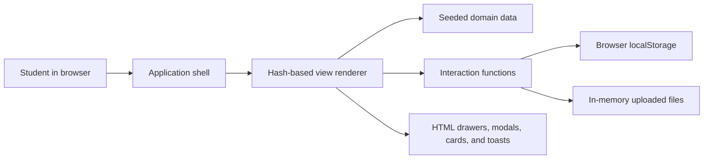
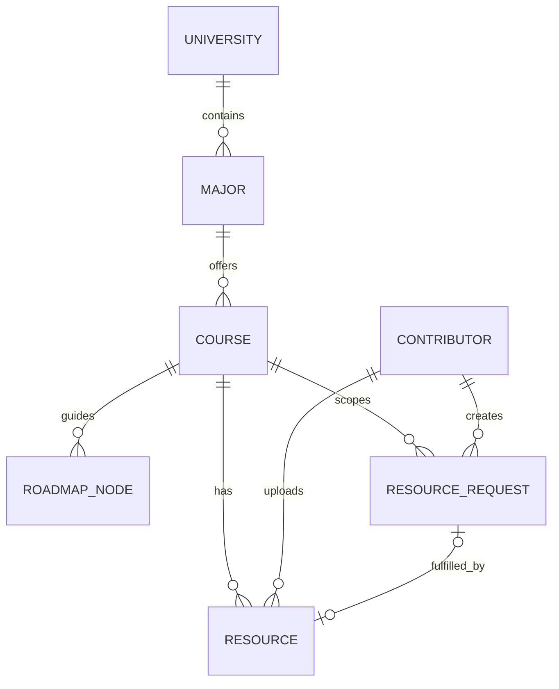
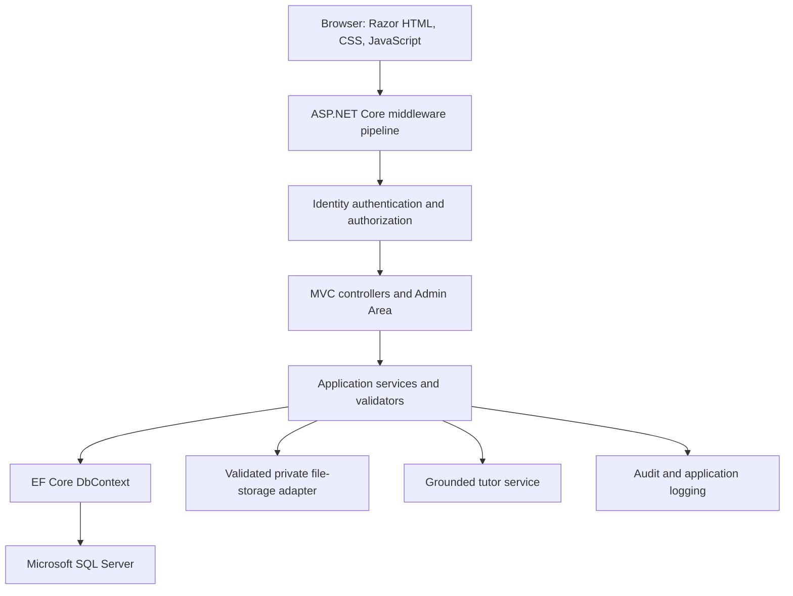

# MASDAR — University Knowledge Hub

MASDAR (مصدر) is a student-centered university knowledge hub for discovering, evaluating, sharing, and discussing course resources. It combines academic context (university, major, and course), community quality signals, guided learning roadmaps, career opportunities, resource requests, and a course-aware AI tutor in one responsive workspace.

> [!IMPORTANT]
> The repository now contains the runnable **ASP.NET Core MVC MVP** plus the original `prototype.html` reference. The application uses SQL Server, Entity Framework Core, ASP.NET Core Identity, role/ownership authorization, private validated uploads, and server-rendered Razor Views. The tutor is intentionally deterministic and locally grounded for this MVP; no external AI provider is required.

For a task-oriented walkthrough, required configuration, development credentials, token requirements, and production checklist, see the **[Project user and configuration guide](USER_GUIDE.md)**.

## Contents

- [Project status](#project-status)
- [Project user and configuration guide](USER_GUIDE.md)
- [Product capabilities](#product-capabilities)
- [How to use the project](#how-to-use-the-project)
- [Legacy prototype reference](#how-the-current-prototype-works)
- [Production architecture and technical design](#production-architecture-and-technical-design)
- [Local setup for the production application](#local-setup-for-the-production-application)
- [Build and runtime verification](#build-and-runtime-verification)
- [Deployment](#deployment)
- [Future enhancements](#future-enhancements)

## Project status

| Capability | Implemented MVP |
| --- | --- |
| Responsive UI | ASP.NET Core MVC, Razor Views, Bootstrap utilities, custom responsive shell, light/dark themes |
| Data | Normalized SQL Server schema through EF Core 8 and a generated `InitialCreate` migration |
| Persistence | SQL Server for domain/user data and private local storage for validated files |
| Authentication | ASP.NET Core Identity registration, login, logout, password management, cookies, Admin/User roles |
| Authorization | Server-enforced role, authenticated mutation, and ownership rules with antiforgery protection |
| File upload | PDF/DOCX up to 10 MB with extension, MIME, signature, path, hash, and DOCX-structure validation |
| Discovery | Asynchronous SQL-backed search, filters, sorting, saved-only queries, and pagination |
| Tutor | Deterministic answers grounded in published course resources with source citations |
| Administration | Protected dashboard plus user, university, major, course, resource, opportunity, and audit management |
| Audit/reputation | Durable activity log and transactional reputation ledger |

The original prototype remains the product and UX reference. Its browser-only simulations have been replaced with real MVC routes, services, Identity users, EF Core transactions, SQL queries, and persistent files.

## Product capabilities

### Workspace and home dashboard

The application shell provides desktop and mobile navigation, global search, active-course context, light/dark themes, notifications, user reputation, and a course switcher. The home dashboard presents:

- the next exam and course-readiness percentage;
- platform resource, course, verification, and helpful-vote statistics;
- the learner's active course and next roadmap milestone;
- quality-ranked resources;
- roadmap progress; and
- relevant student opportunities.

### Course discovery and resource exploration

Students can select a university and major, then add one or more courses to a persistent selection. Search results aggregate resources across the selected courses. Students can:

- filter by resource type;
- search by title, type, uploader, or tag;
- show saved resources only;
- sort by quality, helpful votes, or recency;
- switch the active course without losing the multi-course selection;
- preview and download a resource;
- save, rate, or mark it helpful; and
- ask the AI tutor about a specific resource.

The prototype includes these resource types: previous exams, assignments, quiz banks, lecture summaries, cheat sheets, student notes, recommended videos, and external resources.

### Course workspace

Each course has four views:

1. **Overview** — readiness, exam focus, the next milestone, the AI entry point, and top resources.
2. **Materials** — all course resources ranked by community quality.
3. **Roadmap** — ordered learning milestones with difficulty, exam weight, and per-user completion state.
4. **Career relevance** — practical applications plus workshops, internships, competitions, scholarships, meetups, and other opportunities.

### Resource contribution

The contribution wizard accepts PDF and DOCX files up to 10 MB and guides the student through file selection, metadata, review, permission confirmation, publishing, and success states. Publishing a resource:

- associates it with a course and type;
- adds tags and optional tutor context;
- places it into community review;
- awards 15 reputation points; and
- can fulfill a community request and award its bounty.

### Community and reputation

Students can post resource requests, attach a reputation bounty, vote to prioritize requests, fulfill requests by uploading matching material, and view the contributor leaderboard. A request deducts its bounty from the requester; fulfillment marks the request complete and awards the bounty to the contributor.

### Course-aware AI tutor

The tutor always has an active course context. It offers topic-aware prompts, answers course questions, cites the published resource it used, and can be launched directly from a resource preview. The MVP uses deterministic local grounding; an external-provider evolution is described in [AI and retrieval design](#ai-and-retrieval-design).

## How to use the project

### Prerequisites

- .NET 8 SDK (the repository pins SDK `8.0.319` in `global.json`)
- SQL Server LocalDB, SQL Server Developer/Express, or an accessible Azure SQL database
- EF Core CLI 8.x for creating/updating migrations
- A current version of Chrome, Edge, Firefox, or Safari

### Start the application

The development configuration uses `(localdb)\MSSQLLocalDB`, automatically applies committed migrations, and idempotently seeds demonstration data.

```powershell
cd C:\path\to\masdar
dotnet restore .\Masdar.sln
dotnet ef database update --project .\src\Masdar.Web\Masdar.Web.csproj --startup-project .\src\Masdar.Web\Masdar.Web.csproj
dotnet run --project .\src\Masdar.Web\Masdar.Web.csproj
```

Open the HTTP or HTTPS address printed by `dotnet run`.

Development accounts:

| Role | Email | Password |
| --- | --- | --- |
| Admin | `admin@masdar.local` | `Admin123!` |
| User | `user@masdar.local` | `User123!` |

These credentials are development-only. Override `SeedData__AdminPassword` and `SeedData__UserPassword` outside local development and never reuse them in production.

### Recommended walkthrough

1. Start on **Home** and inspect the current exam, readiness, trusted resources, roadmap, and opportunities.
2. Open **All courses**, filter by university or major, search by course code/name/instructor, and choose a course.
3. Open **Explore resources**, select multiple courses, search, apply a resource-type filter, change the sort order, and toggle **Saved**.
4. Preview a resource. Try **Download**, **Helpful**, a star rating, **Save**, and **Ask AI**.
5. Open the active **Course**. Move between Overview, Materials, Roadmap, and Career relevance. Toggle a milestone and register interest in an opportunity.
6. Open **Contribute**. Choose a PDF or DOCX no larger than 10 MB, enter its metadata, review it, confirm sharing permission, and publish it.
7. Open **Community**. Vote on a request, create a request with a reputation bounty, fulfill a request, and view the contributor leaderboard.
8. Sign in as Admin and open **Admin** to manage users, academic reference data, resources, opportunities, and the audit log.
9. Use the moon/sun control to persist a light/dark preference in browser storage.

Application data is stored in SQL Server. Development uploads are stored outside `wwwroot` under `src/Masdar.Web/App_Data/uploads` and are served only through the authorized download action.

### Current repository layout

```text
masdar/
├── Masdar.sln
├── global.json
├── src/
│   └── Masdar.Web/
│       ├── Areas/Admin/        # Protected administration controllers, ViewModels, and Views
│       ├── Areas/Identity/     # Customized registration and access-denied pages
│       ├── Controllers/        # User/public MVC endpoints
│       ├── Data/               # DbContext, configurations, migrations, and seed data
│       ├── Domain/             # Entities and enums
│       ├── Services/           # Business workflows, storage, querying, audit, and tutor support
│       ├── ViewModels/         # Purpose-built form/read models
│       ├── Views/              # Razor Views and shared shell
│       └── wwwroot/            # CSS, JavaScript, and static assets
├── prototype.html              # Original interactive product reference
├── lucide.min.js               # Prototype-only icon runtime
└── README.md
```

## How the current prototype works

### Runtime architecture

The prototype is a single-document client application:



- **Presentation:** responsive CSS, desktop sidebar, top bar, mobile navigation, cards, drawers, modals, form controls, toasts, and theme tokens live in `prototype.html`.
- **Navigation:** `navigate()` renders `home`, `explore`, `course`, `contribute`, or `community` and mirrors the view in a `#/...` URL fragment.
- **State:** one JavaScript `state` object tracks the active view, academic context, selected courses, filters, upload wizard, course/community tabs, and tutor conversation.
- **Domain data:** `baseData` contains universities, majors, courses, resources, opportunities, requests, contributors, roadmaps, and career mappings. Resource blueprints expand the seed data for every course.
- **Persistence:** selected mutations are serialized to `localStorage`; uploaded binaries remain in an in-memory `Map`.
- **Rendering:** functions such as `renderHome`, `renderExplore`, `renderCourse`, `renderContribute`, and `renderCommunity` generate the active view. There is no frontend framework.
- **Safety in the demo:** dynamic text is passed through `escapeHtml`, and interactive controls expose useful labels and pressed/expanded states. These measures do not replace production server-side security.

### Prototype data relationships



These are conceptual relationships in JavaScript. Referential integrity is not enforced in the prototype.

### What the prototype deliberately does not provide

- real users, registration, login, password management, roles, or authorization;
- SQL Server persistence, transactions, concurrency handling, migrations, or backups;
- durable/private file storage, malware scanning, or server-verified MIME types;
- a real LLM, embeddings, retrieval index, usage limits, or AI safety controls;
- email, push notifications, background jobs, telemetry, or production audit logs;
- a protected administration area; or
- production pagination and database-backed search.

## Production architecture and technical design

### Architectural principles

The production MVP is a modular monolith built with ASP.NET Core MVC. It has one deployable unit and one transactional database while keeping responsibilities separated enough to evolve safely.

- Keep controllers thin: bind input, call services, map outcomes, and select views or redirects.
- Put workflow and authorization rules in application services, not Razor Views or JavaScript.
- Use dedicated input/output ViewModels; never bind EF Core entities directly to mutable forms.
- Query through the EF Core `DbContext` with async APIs and project directly into read models.
- Use server-side authorization for every protected action, even when the UI hides the control.
- Prefer explicit domain services over a generic repository abstraction that only duplicates EF Core.
- Treat uploads and AI providers as replaceable infrastructure behind interfaces.
- Use optimistic concurrency where moderators and users may edit the same record.

### Runtime request flow



### Required technology stack

- ASP.NET Core MVC and C#
- Razor Views, HTML5, CSS3, JavaScript, and Bootstrap where it improves accessibility or responsiveness
- Entity Framework Core with the SQL Server provider
- Microsoft SQL Server or Azure SQL Database
- ASP.NET Core Identity for users, passwords, roles, claims, and cookies
- Built-in dependency injection, configuration, logging, antiforgery, and data protection

The solution targets .NET 8, pins SDK `8.0.319` in `global.json`, and pins EF Core/Identity packages to `8.0.22`.

### Solution structure

```text
Masdar.sln
└── src/
    └── Masdar.Web/
        ├── Areas/
        │   ├── Admin/
        │   │   ├── Controllers/
        │   │   ├── ViewModels/
        │   │   └── Views/
        │   └── Identity/               # Scaffold only pages that require customization
        ├── Controllers/
        ├── Data/
        │   ├── ApplicationDbContext.cs
        │   ├── Configurations/          # IEntityTypeConfiguration<T>
        │   ├── Migrations/
        │   └── Seed/
        ├── Domain/
        │   ├── Entities/
        │   └── Enums/
        ├── Services/                     # Contracts and implementations
        ├── ViewModels/
        ├── Views/
        │   ├── Shared/
        │   └── ...
        ├── wwwroot/
        │   ├── css/
        │   ├── js/
        │   └── images/
        ├── App_Data/uploads/            # Private development uploads; excluded from source control
        ├── appsettings.json
        ├── appsettings.Development.json
        └── Program.cs
```

The single web project is appropriate for the MVP. Split into separate Domain/Application/Infrastructure projects only when independent boundaries or team size justify the extra ceremony.

### Domain model

The normalized production model contains the following records.

#### Identity and academic context

- **ApplicationUser** — Identity user plus display name, status, university/major references, reputation balance, profile image reference, and audit timestamps.
- **University** — unique normalized name, optional logo, location/contact details, and active status.
- **Major** — belongs to a university; name is unique within that university.
- **Course** — belongs to a major; code, name, instructor, semester, exam date, and active status. Course code should be unique within the relevant academic scope.
- **UserCourse** — a user's selected courses, active-course flag, and selection timestamps.

#### Resources and quality

- **StudyResource** — course, uploader, title, type, semester, summary/tutor text, publication/verification state, representative flag, private storage key, original display name, content type, size, checksum, scan state, and audit timestamps. File bytes do not live in SQL Server.
- **Tag** and **ResourceTag** — normalized many-to-many resource tagging.
- **ResourceRating** — one 1–5 rating per user/resource pair; aggregate rating is calculated or maintained transactionally.
- **ResourceHelpfulVote** — one helpful vote per user/resource pair.
- **SavedResource** — one user/resource bookmark pair.

#### Learning, community, and opportunities

- **RoadmapNode** — ordered course milestone with description, difficulty, and exam-weight percentage.
- **UserRoadmapProgress** — unique user/node pair with completion state and completion timestamp.
- **ResourceRequest** — requester, course, desired resource type, title, bounty, state, and optional fulfilling resource.
- **ResourceRequestVote** — one vote per user/request pair.
- **Opportunity** — type, title, description, start/end dates, registration URL or internal workflow, capacity, publication state, and active status.
- **OpportunityRegistration** — one user/opportunity RSVP pair.
- **ActivityLog** — actor, action type, target entity/type, target ID, timestamp, and safe metadata for administrative auditing.

#### Important database constraints and indexes

- Unique indexes on normalized university names and on `(UniversityId, NormalizedMajorName)`.
- Unique composite indexes on user actions: `(UserId, ResourceId)` for ratings, helpful votes, and saved resources; `(UserId, RequestId)` for request votes; `(UserId, RoadmapNodeId)` for progress; and `(UserId, OpportunityId)` for registrations.
- Indexes for resource discovery on `(CourseId, PublicationStatus, ResourceType)`, creation date, verification state, and uploader.
- Indexes for request state/course/vote ordering and opportunity publication/start dates.
- Foreign-key delete behavior chosen explicitly: restrict deletion of academic reference data, soft-delete user-facing content where audit/history matters, and cascade only dependent join records.
- `rowversion` concurrency tokens on records commonly edited by users and administrators.
- UTC timestamps (`CreatedAtUtc`, `UpdatedAtUtc`) for persisted events; convert only at the presentation boundary.

### Roles and authorization

The minimum roles are **User** and **Admin**. Admin inherits normal product access and adds platform-management capabilities.

| Action | Anonymous | User | Admin |
| --- | :---: | :---: | :---: |
| View public home/course/resource metadata | ✓ | ✓ | ✓ |
| Download, save, rate, vote, track progress, or RSVP |  | ✓ | ✓ |
| Upload a resource or create a request |  | ✓ | ✓ |
| Edit/delete own eligible content |  | ✓ | ✓ |
| Moderate any resource/request |  |  | ✓ |
| Manage users, universities, majors, courses, opportunities, and reference data |  |  | ✓ |
| View platform statistics and audit activity |  |  | ✓ |

Use `[Authorize]` for authenticated workflows and `[Authorize(Roles = "Admin")]` on the Admin Area or an equivalent authorization policy. Every update/delete service must also verify ownership or admin rights by using the authenticated user ID from `UserManager`; never accept an owner ID from a posted form.

Inactive accounts should be rejected during cookie validation. Administrative role changes and account deactivation must be audited.

### MVC surface and services

Expected public/user controllers include `HomeController`, `CoursesController`, `ResourcesController`, `ContributionsController`, `CommunityController`, `OpportunitiesController`, `RoadmapController`, `ProfileController`, and `TutorController`. The Admin Area should contain focused controllers for the dashboard, users, universities, majors, courses, resources/moderation, opportunities, requests, and activity logs.

Important service boundaries include:

- `ICourseService` — catalog, academic context, course workspace, and roadmap reads;
- `IResourceService` — discovery queries, details, ownership-aware edits, publishing, moderation, and aggregate quality;
- `IFileStorageService` — safe upload, read, delete, and provider-independent storage keys;
- `ICommunityService` — requests, votes, fulfillment, bounty transfers, and leaderboard;
- `IOpportunityService` — opportunity publication and registrations;
- `IReputationService` — idempotent reputation ledger operations;
- `ITutorService` — retrieval, prompt construction, provider calls, citations, and safety limits; and
- `IAuditService` — structured records for important administrative actions.

Reputation and request fulfillment must run in a database transaction. Prefer a reputation ledger over modifying a counter without history; the displayed balance can be calculated or cached.

### Representative routes

| Method | Route | Behavior |
| --- | --- | --- |
| `GET` | `/` | Home dashboard |
| `GET` | `/Courses` | Filtered/searchable course catalog |
| `GET` | `/Courses/{id}` | Overview, materials, roadmap, and career content |
| `GET` | `/Resources` | Paginated multi-course discovery query |
| `GET` | `/Resources/{id}` | Resource metadata and quality details |
| `GET` | `/Resources/{id}/Download` | Authorized, audited file response or short-lived storage URL |
| `POST` | `/Resources/{id}/Save` | Idempotent save/unsave action |
| `POST` | `/Resources/{id}/Rate` | Create or replace the user's rating |
| `POST` | `/Resources/{id}/Helpful` | Idempotent helpful-vote toggle |
| `GET/POST` | `/Contributions/Create` | Validated upload workflow |
| `GET/POST` | `/Community/Requests/Create` | Create a request and reserve its bounty |
| `POST` | `/Community/Requests/{id}/Vote` | Idempotent request vote |
| `POST` | `/Roadmap/{nodeId}/Toggle` | Update current-user progress |
| `POST` | `/Opportunities/{id}/Register` | Create/remove an RSVP |
| `POST` | `/Tutor/Ask` | Rate-limited, grounded AI response |

Use POST/Redirect/GET for form workflows. Lightweight interactions may return partial HTML or JSON to unobtrusive JavaScript, but each state-changing route still requires authentication, validation, antiforgery protection, and server-side authorization.

### Search, filtering, sorting, and pagination

Resource discovery should build one `IQueryable` from validated query parameters:

1. restrict to published resources and permitted course IDs;
2. apply university, major, selected-course, type, saved-only, and text filters;
3. apply a deterministic sort with an ID tie-breaker; and
4. project to a card ViewModel before `Skip`/`Take` and `ToListAsync()`.

For the MVP, normalized columns plus SQL indexes and carefully bounded `LIKE` queries are sufficient. SQL Server full-text search can be introduced when relevance requirements outgrow basic matching. Never load the full resource table and filter in JavaScript.

### File upload and download design

The prototype's contract is PDF/DOCX up to 10 MB. Production handling must:

- verify extension, declared content type, and file signature on the server;
- enforce the size limit while streaming and reject empty files;
- generate a random storage name and retain the original name only as display metadata;
- store files outside the web root or in private blob storage;
- scan uploads before making them downloadable/indexable;
- serve downloads through an authorized endpoint or short-lived signed URL;
- set safe `Content-Disposition` and `X-Content-Type-Options: nosniff` headers;
- avoid exposing physical paths or storage credentials; and
- define retention/orphan-cleanup behavior when a database operation or upload fails.

Local disk storage is acceptable for development. Azure Blob Storage or another private object store is preferred for horizontally scaled production deployments.

### AI and retrieval design

The production tutor should use retrieval-augmented generation, not send every course file to a model on every question.

1. Accept an authenticated user question and explicit course/resource context.
2. Retrieve only approved, malware-scanned, text-extracted chunks from the authorized course.
3. Rank a bounded number of chunks and construct a prompt that treats resource text as untrusted data, not instructions.
4. Call the configured AI provider with timeouts, cancellation, token limits, and retry rules for transient failures.
5. Return an answer with resource citations; clearly state when evidence is insufficient.
6. Log operational metadata without storing sensitive prompts or document contents unnecessarily.

Add per-user/IP rate limits, input/output size limits, moderation appropriate to the deployment, and cost/latency telemetry. Keep provider credentials in environment configuration or a secret store. The application must remain usable for browsing/downloading when the AI provider is unavailable.

### Validation and business rules

- Trim and length-limit all names, titles, tags, summaries, and search terms.
- Validate that university → major → course relationships are consistent.
- A user may submit at most one rating/helpful vote/save/request vote for the same target.
- Ratings are integers from 1 through 5.
- Roadmap weight is between 0 and 100; ordered nodes are unique per course.
- A request bounty must be one of the supported values and cannot exceed the user's available reputation.
- Bounty reservation, fulfillment, and reputation awards are transactional and idempotent.
- A request may be fulfilled once and only by a published resource for the same course and compatible type.
- Opportunity end/registration dates cannot precede their start/publication dates.
- Draft, rejected, archived, and unscanned resources must not appear in user discovery or download results.
- Duplicate posts and concurrent edits should produce clear validation/concurrency messages rather than silent overwrites.

Use Data Annotations for simple field validation and service/domain validation for cross-field or database-dependent rules. Client validation improves UX but never substitutes for server validation.

### Security baseline

- Identity password hashing, confirmed account policy as required, secure HTTP-only cookies, short-lived security stamps, and lockout protection.
- HTTPS redirection, HSTS in production, secure proxy/forwarded-header configuration, and persisted Data Protection keys for multi-instance deployments.
- Global antiforgery validation for unsafe MVC requests.
- Role/policy authorization plus per-record ownership checks.
- Over-posting prevention through purpose-built ViewModels and explicit mapping.
- Razor's default output encoding; avoid raw HTML for user content unless sanitized with an allowlist.
- Content Security Policy and restrictive headers appropriate to deployed assets.
- Rate limiting on login, registration, search, requests, downloads, uploads, and tutor endpoints.
- Secrets supplied through user secrets, environment variables, managed identity, or a secret manager—never committed configuration.
- Database access through a least-privileged account; migrations run by a controlled deployment identity where practical.
- Structured logs that exclude passwords, tokens, connection strings, raw uploaded content, and unnecessary personal data.

### Error handling, logging, and observability

Configure `UseExceptionHandler` and `UseStatusCodePagesWithReExecute` outside development. Provide branded 404, 403/Access Denied, and general error pages without stack traces. Translate expected domain failures into validation messages and log unexpected failures with a correlation ID.

At minimum, capture:

- request duration, response status, and unhandled exceptions;
- login/lockout and authorization failures without sensitive values;
- upload scan/index outcomes;
- AI latency, provider outcome, and token/cost measurements;
- database health and slow queries; and
- administrative activities in the durable audit table.

Add health endpoints for application liveness and dependencies such as SQL Server, storage, and the optional AI provider. Availability of AI should not determine the application's basic readiness.

### Admin Area

The protected Admin dashboard should show user, university, major, course, published/pending resource, request, registration, and recent-activity statistics. Admin workflows should support:

- user search, details, activation/deactivation, and controlled role management;
- university, major, course, semester, instructor, and exam-date management;
- resource moderation, verification, representative status, archive/removal, and download inspection;
- resource type/tag/reference-data management where it is genuinely required;
- request and reputation dispute handling;
- opportunity publishing and registration monitoring; and
- searchable audit history.

Every list should be server-filtered and paginated. Destructive actions require confirmation, POST, antiforgery protection, an explicit service rule, and an audit entry.

### Prototype-to-production mapping

| Prototype concept | Production implementation |
| --- | --- |
| `baseData` JavaScript object | EF Core entities, migrations, and development seed service |
| Global `state` object | Route/query/form state plus authenticated per-user database records |
| Hash navigation | MVC routes, controllers, Razor Views, and PRG form redirects |
| Render functions | Views, partials, ViewModels, and small progressive-enhancement scripts |
| `localStorage` interactions | SQL Server records scoped to the authenticated user |
| `runtimeFiles` map | Private file-storage adapter and `StudyResource` storage metadata |
| Simulated tutor | Retrieval service plus configurable AI provider |
| Hard-coded “Student Ahmed” | `ApplicationUser` from ASP.NET Core Identity |
| Inline quality totals | Transaction-safe user actions and server-computed aggregates |
| Immediate demo publish | Published-but-unverified resource with scan/moderation gates |

### Product-scope clarification

The prototype defines MASDAR as a course-resource and learning-community product. A competition appears only as one possible **Opportunity** type. Generic competition administration described in earlier broad requirements is therefore not a core module unless separate product designs and business rules are supplied. Following the stated “prototype as source of truth” rule, the production design prioritizes courses, resources, roadmaps, community requests, opportunities, reputation, moderation, and the tutor.

## Local setup for the production application

The solution is ready to restore, migrate, seed, and run. Development seeding is idempotent, so restarting the application does not duplicate records.

### Requirements

- .NET SDK matching the committed target framework
- SQL Server Developer/Express, SQL Server in a local container, or an accessible Azure SQL database
- EF Core command-line tools matching the project's EF Core major version
- Optional external AI/private object-storage credentials only when replacing the built-in MVP adapters

### Configuration

Keep only a non-secret placeholder in `appsettings.json`:

```json
{
  "ConnectionStrings": {
    "DefaultConnection": ""
  }
}
```

For local development, use .NET user secrets:

```powershell
dotnet user-secrets init --project .\src\Masdar.Web\Masdar.Web.csproj
dotnet user-secrets set "ConnectionStrings:DefaultConnection" "Server=(localdb)\MSSQLLocalDB;Database=MasdarMvp;Trusted_Connection=True;MultipleActiveResultSets=true;TrustServerCertificate=True" --project .\src\Masdar.Web\Masdar.Web.csproj
```

Use environment variables in hosted environments, for example `ConnectionStrings__DefaultConnection`. Configure AI/storage secrets the same way. Do not add real credentials to either `appsettings.json` or `appsettings.Development.json`.

### Restore, migrate, seed, and run

```powershell
dotnet restore .\Masdar.sln
dotnet ef database update --project .\src\Masdar.Web\Masdar.Web.csproj --startup-project .\src\Masdar.Web\Masdar.Web.csproj
dotnet run --project .\src\Masdar.Web\Masdar.Web.csproj
```

When `SeedData:Enabled` is true in Development, startup creates Admin/User roles, two development accounts, 7 universities, 14 majors, 20 courses, approximately 160 resources, roadmaps, requests, opportunities, reputation records, and registrations. Seeded downloadable documents are stored through the same validated private-storage service used by contributions.

### Development accounts

The checked-in development configuration uses the accounts listed in [Start the application](#start-the-application). Override them with user secrets when needed:

```powershell
dotnet user-secrets set "SeedData:AdminEmail" "admin@example.test" --project .\src\Masdar.Web\Masdar.Web.csproj
dotnet user-secrets set "SeedData:AdminPassword" "<strong-local-only-password>" --project .\src\Masdar.Web\Masdar.Web.csproj
```

Never document or commit a reusable plaintext production password. Force a password change or provision administrators through an approved deployment process before a real launch.

## Build and runtime verification

No automated test project is included, per the requested scope. The implemented solution was verified through compilation, database migration/seeding, and direct runtime requests.

```powershell
dotnet build .\Masdar.sln --no-restore
```

Verified results:

- build succeeds with zero warnings and zero errors;
- `InitialCreate` applies successfully to SQL Server LocalDB;
- development seed data and Admin/User roles are created idempotently;
- Home, course catalog/details, resource catalog/details, community, login, and registration render successfully;
- unauthenticated Admin access is challenged and redirected to login; and
- authenticated Admin dashboard, users, universities, majors, courses, resources, opportunities, and audit-log pages render successfully.

## Deployment

### General release process

1. Build a deterministic release with `dotnet publish`.
2. Provision SQL Server/Azure SQL, private file storage, secret management, persistent Data Protection keys, and centralized logs.
3. Supply production configuration externally; do not transform committed files with secrets.
4. Back up the database and apply reviewed EF Core migrations as a controlled release step.
5. Deploy the application, run health checks and a smoke test, then enable traffic.
6. Verify Admin authorization, file upload/download, audit logging, error handling, HTTPS, and rollback procedures.

Example publish command:

```powershell
dotnet publish .\src\Masdar.Web\Masdar.Web.csproj -c Release -o .\artifacts\publish
```

### Azure App Service + Azure SQL

- Deploy the published ASP.NET Core application to App Service.
- Use Azure SQL with encrypted connections and a least-privileged identity; prefer managed identity where supported.
- Store user files in a private Blob Storage container, not the App Service filesystem.
- Store secrets in App Service settings/Key Vault references and persist Data Protection keys outside the instance.
- Configure health checks, Application Insights or equivalent telemetry, HTTPS-only access, backups, scale settings, and deployment slots.
- Run migrations from CI/CD or a one-off release task, not independently from every scaled web instance.

### IIS + SQL Server

- Install the matching ASP.NET Core Hosting Bundle on the IIS server.
- Create a dedicated application pool with **No Managed Code** and a least-privileged service identity.
- Publish to a versioned deployment directory and grant only required read/write access; keep uploads outside the public web root.
- Configure the SQL connection and other secrets outside source control.
- Terminate HTTPS correctly, configure forwarded headers if behind a proxy, persist Data Protection keys, and centralize logs/backups.
- Apply migrations in a controlled maintenance/release step before switching the site to the new version.

## Future enhancements

The MVP is intentionally a modular monolith. Natural next production steps are:

1. replace local file storage with private Azure Blob Storage and a real malware-scanning queue;
2. replace deterministic tutor generation with a configured retrieval/embedding and AI-provider adapter;
3. add verified email delivery, account recovery branding, and production administrator provisioning;
4. add distributed rate limiting, CSP reporting, centralized telemetry, and dependency health checks;
5. add background text extraction/indexing for approved PDF/DOCX resources; and
6. add CI/CD migration, backup, deployment-slot, and rollback automation.

The current MVP builds cleanly, applies its migration to an empty database, seeds usable development data, enforces authenticated and Admin operations server-side, stores uploaded files privately, and provides production configuration/deployment guidance.

## License

No license has been specified. Until one is added, treat the source as all rights reserved and do not assume permission to redistribute it.
